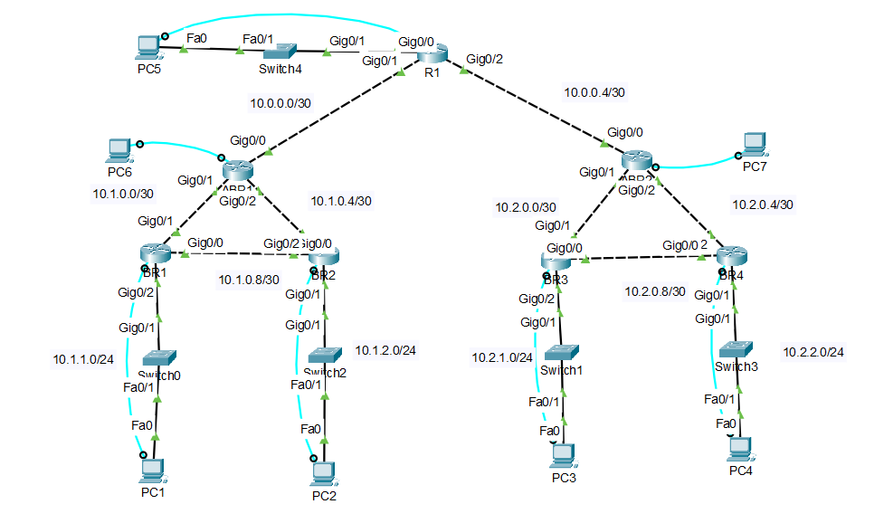

# Multi Area OSPF Network

A company network with a head office and two branches, built in Cisco Packet Tracer using multi area OSPF and route summarization.

## Overview

I split the network into three OSPF areas: a backbone (Area 0) and one area per branch. Area Border Routers (ABRs) connect each branch to the backbone, and each ABR summarizes its whole branch into a single route. Every PC can reach every other PC and the head office router, and I tested it with pings and traceroutes between the areas.

## Topology

| Area | Routers | Networks |
|---|---|---|
| Area 0 (Backbone) | R1, ABR1, ABR2 | 10.0.0.0/30, 10.0.0.4/30, HQ LAN 10.0.10.0/24 |
| Area 1 (Branch A) | ABR1, BR1, BR2 | 10.1.0.0/30, 10.1.0.4/30, 10.1.0.8/30, 10.1.1.0/24, 10.1.2.0/24 |
| Area 2 (Branch B) | ABR2, BR3, BR4 | 10.2.0.0/30, 10.2.0.4/30, 10.2.0.8/30, 10.2.1.0/24, 10.2.2.0/24 |

Router IDs come from loopbacks: R1 1.1.1.1, ABR1 2.2.2.2, ABR2 3.3.3.3, BR1 4.4.4.4, BR2 5.5.5.5, BR3 6.6.6.6, BR4 7.7.7.7.

## How It Works

1. **Areas:** Each branch is its own area. Traffic between branches always goes through Area 0.
2. **Backup links:** BR1 and BR2 (and BR3 and BR4) are linked to each other, so traffic inside a branch stays local and each branch router has a second way to reach its ABR.
3. **Summarization:** ABR1 runs `area 1 range 10.1.0.0 255.255.0.0` and ABR2 runs `area 2 range 10.2.0.0 255.255.0.0`, so each branch is sent into the backbone as one /16 instead of five separate routes.
4. **Reference bandwidth:** `auto-cost reference-bandwidth 100000` on every router so OSPF can tell gigabit links apart.

## Issues I Ran Into

1. **HQ LAN not advertised:** At first R1 only advertised its backbone links and loopback, so the branches had no route to 10.0.10.0/24. Adding `network 10.0.10.0 0.0.0.255 area 0` on R1 fixed it.

## Results

1. PC2 to PC1 stays inside Area 1 using the BR2 to BR1 link (10.1.2.1, 10.1.0.9, PC1).
2. PC1 and PC4 both reach R1's loopback 1.1.1.1 through their ABR.
3. PC4 to PC1 crosses from Area 2 through the backbone into Area 1 (10.2.2.1, 10.2.0.5, 10.0.0.5, 10.0.0.2, 10.1.0.2, PC1).

## What I Learned

1. Traffic between areas always passes through Area 0.
2. Planning IP addresses per area makes summarization a single command on each ABR.
3. The reference bandwidth has to match on every router.

## Files

1. `Multi Area OSPF Network.pdf`: full project documentation with screenshots
2. `configs/`: configuration commands for [R1](configs/R1.txt), [ABR1](configs/ABR1.txt), [ABR2](configs/ABR2.txt), [BR1](configs/BR1.txt), [BR2](configs/BR2.txt), [BR3](configs/BR3.txt), and [BR4](configs/BR4.txt)

## Tools

Cisco Packet Tracer
